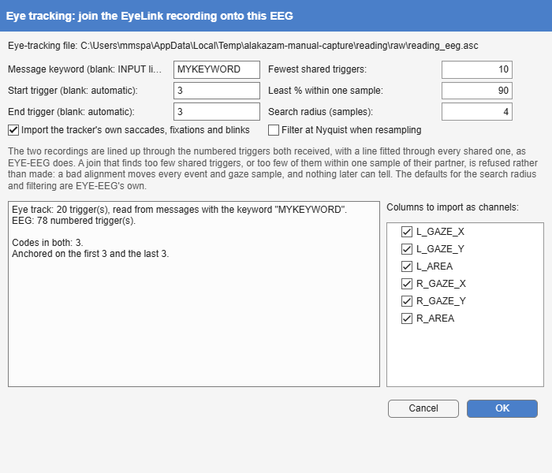

*Tools > 1. Preprocessing > EyeTracking · continuous → continuous ·
`EyeTracking`*

Joins the EyeLink recording of the same session onto the EEG, using EYE-EEG
[@dimigen2011]: the tracker's clock is aligned with the EEG's through the
triggers both received, its gaze and pupil signals are added as channels of
type `EYE` (which nothing treats as scalp EEG), and its saccades, fixations
and blinks are added as events. Those events can then be binned like any
other (fixation-related potentials) and modelled as covariates in
deconvolution ([Overlap correction by deconvolution](https://markspan.github.io/AlakazamDeconvolve/#sec-deconvolution)).

The eye-tracking file is found by name: `subject1.set` goes with
`subject1.asc` beside it, which is what lets one set of options be replayed
on every subject. When only an `.edf` is present and SR Research's
`edf2asc` is installed, it is converted first.

{#fig-eyetracking-dialog}

| Option | Default | Meaning |
|-------------------------------------------------------|---------|-------------------------------------------------------|
| **Message keyword** | blank | The keyword of the EyeLink messages that carry the triggers (`MYKEYWORD 123`); blank reads the parallel-port input lines instead. |
| **Start trigger**, **End trigger** | automatic | The codes the alignment is anchored on (the first of the one, the last of the other); automatic takes the first and last code both recordings share. |
| **Import the tracker's own saccades, fixations and blinks** | on | Add them as events. |
| **Filter at Nyquist when resampling** | off | EYE-EEG's own option, and its default. |
| **Fewest shared triggers** | 10 | Refuse a join with fewer. |
| **Least % within one sample** | 90 | Refuse a join in which fewer of the shared triggers end up within one sample of their partner. |
| **Search radius** | 4 samples | How far either side of an EEG trigger to look for its partner (EYE-EEG's default). |
| **Columns to import** | all | The tracker's columns to add as channels, by name. |

: Eye tracking's options. {#tbl-eyetracking}

A poor synchronisation is silent: every event lands a little away from the
EEG it belongs to, and nothing downstream can tell. The join is therefore
checked. EYE-EEG returns the dataset unchanged when it finds no shared
triggers, and that is refused; its record of how far each shared trigger
landed from its partner is summarised and refused below the two limits
above; and the summary is kept, so that the data-quality report states the
synchronisation for every subject ([Data quality](https://markspan.github.io/Alakazam/#sec-data-quality)).

{#fig-eyetracking-result}
